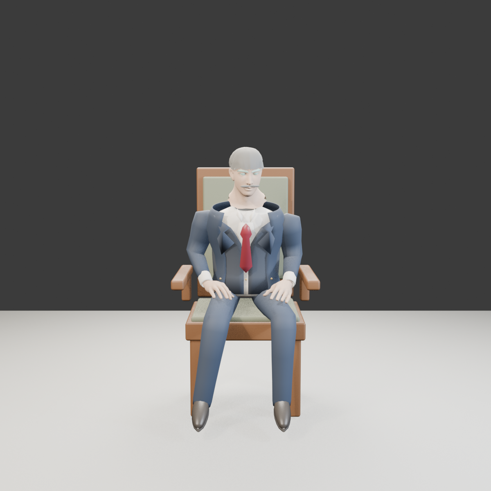

# CASES-GUI — Suited Negotiator V2

CASES is an educational 3D negotiation game. This repository contains the Godot 4 character prototype and its reproducible Blender asset pipeline. The separate FastAPI backend and Local-AI-API-LITE are not part of this repository.

## Character pipeline

The V2 generator keeps the vendored Quaternius humanoid and its compatible 65-bone skeleton. The supplied Universal Base Character file contains the `SuperHero_Male` mesh, but no regular male alternative. It adds an editable `CASES average-build correction` shape key to the source mesh; the exported visible skin is limited to the head/neck and hands, while configurable garment profiles define the slimmer visible silhouette.

Garments are generated in Blender from reusable meter-scale parameters in `PRESET` in [build_suited_negotiator.py](art_source/scripts/build_suited_negotiator.py). The torso uses a profiled jacket shell, separate shirt and waistcoat panels, a fitted collar and tie, and surface-conforming notched lapels. Sleeve rings use the upper-arm, elbow, and wrist rest-pose joints to define their centers and local cross-sections. Vertex weights blend across the upper arm, elbow, lower arm, and hand. Small hollow shirt cuffs sit inside the jacket sleeves and follow the wrist bones. Trouser rings follow thigh, knee, and calf bones, and low-profile dress shoes follow each foot bone. The generator normalizes weights and rejects missing bone names.

Blender produces an editable `.blend`, a Godot-ready skinned GLB, eight 1200×1200 preview renders, and six talking-animation frame samples. The build script combines the requested views into a contact sheet and runs Godot import, animation, skin-binding, and proportion checks.

## Open the demo

Project directory: `D:\projects\Cases-GUI\godot`

Open `godot/project.godot` in Godot 4.7.2 and run the main scene.

- `1`: seated idle
- `2`: seated talking
- `3`: pause or resume

The demo remains a single seated actor and chair. It does not include multi-participant placement, backend integration, or dialogue systems.

## Rebuild and validate

From the repository root, run:

```powershell
.\build_and_validate.ps1
```

The script discovers Blender and Godot on `PATH`, then falls back to documented Windows defaults. You can override them with `-BlenderPath` and `-GodotPath`, or set `BLENDER_EXE` and `GODOT_EXE`.

The build runs the Blender generator, checks generated assets and all required preview dimensions, creates `comparison_contact_sheet.png`, imports the GLB in Godot, runs `godot/tests/validate_suit.gd`, and starts the demo headlessly. It returns a nonzero status if any required step fails.

To open the demo directly in Godot after generation:

```powershell
& 'D:\tools\Godot-4.7.2\Godot_v4.7.2-stable_win64.exe' --path godot
```

The main previews and talking samples are under `art_source/output/v2/`. The baseline idle and talking renders are preserved under `art_source/output/v2/before/` for comparison. Previous and current validation notes are in [docs/TEST_RESULTS.md](docs/TEST_RESULTS.md).

## V2 visual review




## Asset provenance and limitations

The base character and two seated actions remain Quaternius-derived GLBs. License notices and the exact redistributions are recorded in [docs/ASSET_PROVENANCE.md](docs/ASSET_PROVENANCE.md). No third-party suit geometry has been added.

This is a polished stylized low-poly character rather than a photoreal historical portrait. Facial features, lapel folds, and shoe forms remain deliberately simple. The current build validates the idle and talking loops at sampled times; it does not claim exhaustive collision-free results for every possible pose.
