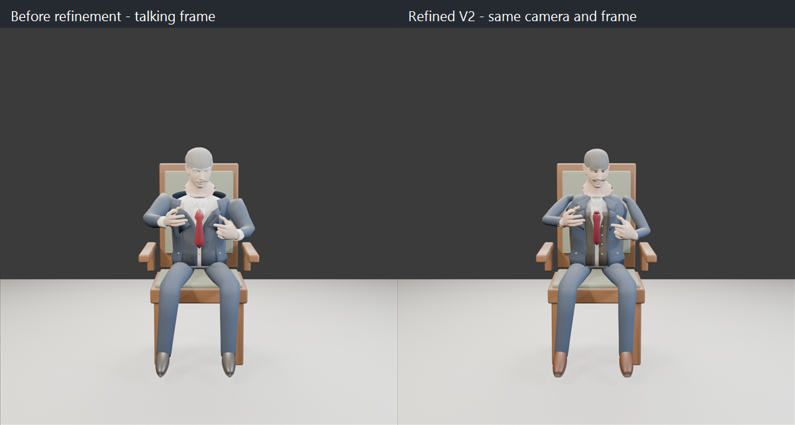
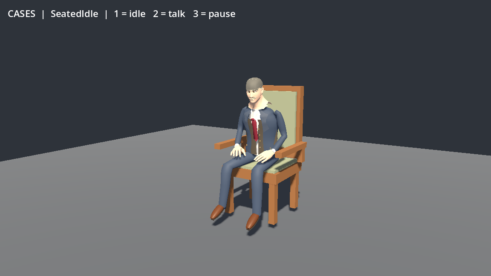

# Suited Negotiator V2 - refinement validation

Recorded 18 November 2026 on Windows with Blender 4.2.2 and Godot 4.7.2 stable. Run from the `D:\projects\Cases-GUI` repository root with `.\build_and_validate.ps1`.

## Refinement work

The Quaternius `SuperHero_Male` source and 65-bone skeleton remain in place. `PRESET` now drives the narrower shoulder and chest profile, a slimmer bone-aligned sleeve profile, fitted short cuffs, reduced shirt neckline, and waistcoat opening. Sleeves follow the shoulder, upper-arm, elbow, and forearm rest-pose joints; weights blend from clavicle to upper arm and across the elbow. The non-destructive corrective shape key now includes a modest neck width/depth correction.

The jacket opening and lapel panels were reshaped around the neck and chest, the waistcoat is a darker distinct layer, the shirt/tie colors are muted, and the tie has a smaller knot. Cuffs now have a 0.048 m outside diameter and 0.034 m length and remain weighted to the moving wrist. Trousers use narrower bone-following ring radii with less front-to-back depth; shoes have a broader toe and warm brown leather material. Eyes use a warm ivory material with brown irises and pupils; brows and a single close-set moustache use the hair material. The hair cap has a small asymmetric hairline variation rather than separate floating strand pieces.

## Full build and Godot validation

`build_and_validate.ps1` completed successfully after the final generator update. It refreshed the editable Blender file and Godot GLB, all eight preview renders, six talking samples, comparison sheets, and the Godot capture.

- Godot imported the expected 65-bone skeleton and both `SeatedIdle` and `SeatedTalking` clips.
- **38 character and garment skinned meshes / 38 weighted surfaces** passed valid-bone and normalized-weight checks.
- The validator sampled seven times in each clip, including both endpoints; both clips applied bone transforms and the character root stayed fixed.
- Pelvis height at the comparison sample was **0.583530 m** in both clips.
- Sleeve, cuff, trouser, and shoe dimension guards passed.
- The Compatibility-renderer demo started without runtime errors.
- A real Godot frame was captured through Movie Maker at **1152 x 648**. This resolves the earlier black GUI screenshot for the target-engine visual check.

The complete build log is `art_source/output/v2/build_validation_transcript.txt`; the Godot capture log is `art_source/output/v2/godot_capture.log`.

## Visual review

Blender rendered eight 1200 x 1200 views and six talking frames at 1, 10, 22, 30, 45, and 60. Frames 22 and 30 show the arms crossing the chest. The full view set is `art_source/output/v2/`; the contact sheet is `comparison_contact_sheet.png`. A same-camera, same-frame comparison against the saved pre-refinement render is `before_after_talking_comparison.png`. The previous V2 baseline is preserved under `before/`, and the exact pre-refinement state for this pass is preserved under `pre_refinement/`.

The talking poses show a slimmer sleeve/cuff outline than the pre-refinement render, clearer waistcoat and lapel separation, darker eyes and hair, and brown dress shoes. Hands remain connected through the inspected poses.

## Remaining limitations

The character is still stylized low-poly. The shoulders and upper arms are slimmer but retain a rounded cap. A small dark inner-collar arc and angular skin-to-collar transition remain visible in close-up; the shirt, waistcoat, lapels, and tie read more clearly but still have simplified facets. Trouser legs remain smooth. The Godot capture confirms the imported scene renders and shows the whole chair/character composition, though the game camera leaves substantial surrounding space. Technical checks do not imply flawless tailoring or collision-free deformation at every interpolated time. Current visual inspection covers the saved six talking frames and the required idle/talking preview views.

## Reproduction

From the repository root, run `.\build_and_validate.ps1`. The script locates Blender and Godot from command-line arguments, environment variables, `PATH`, or its documented Windows defaults. It regenerates the character, imports it into Godot, runs `godot/tests/validate_suit.gd`, starts the demo headlessly, and captures a Compatibility-renderer PNG.