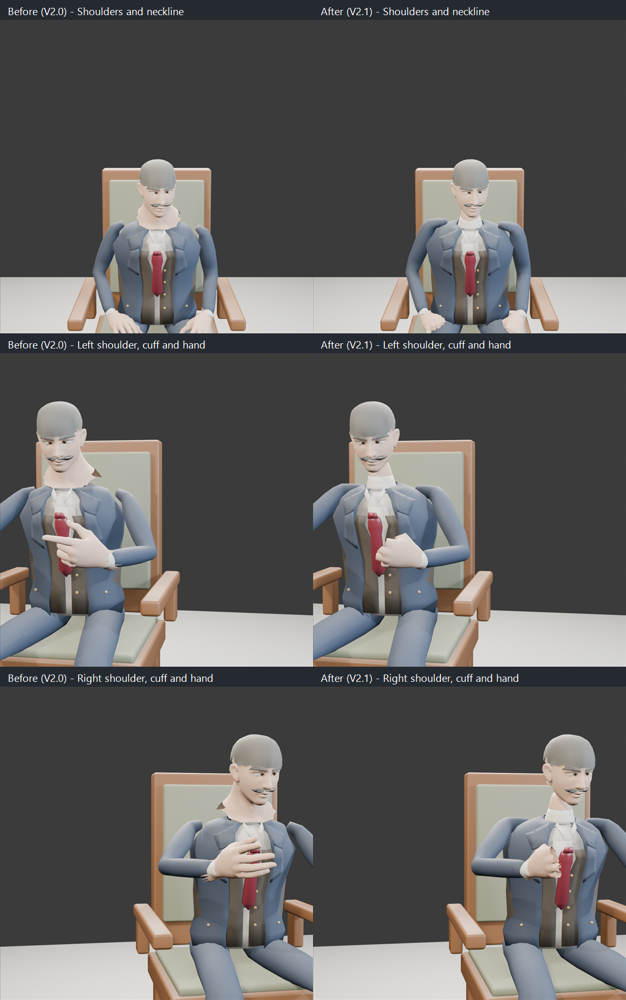
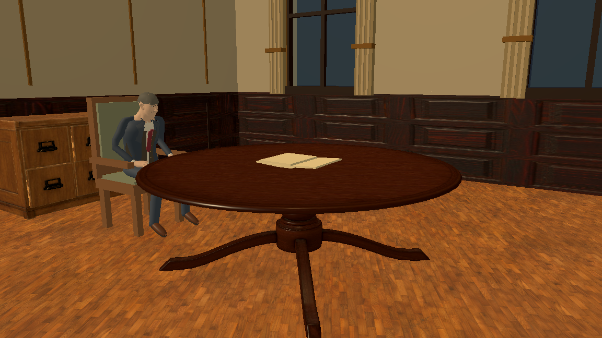
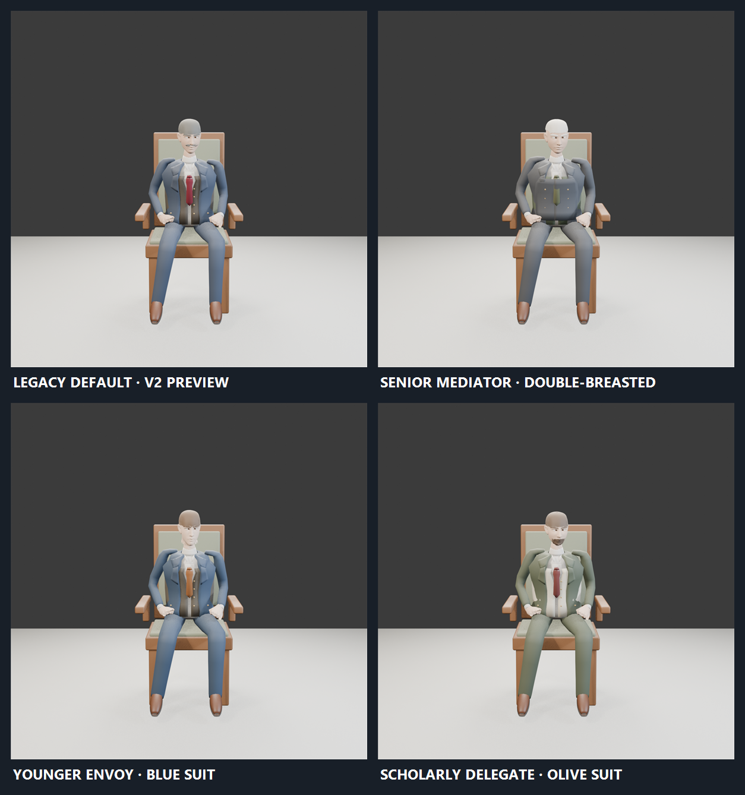
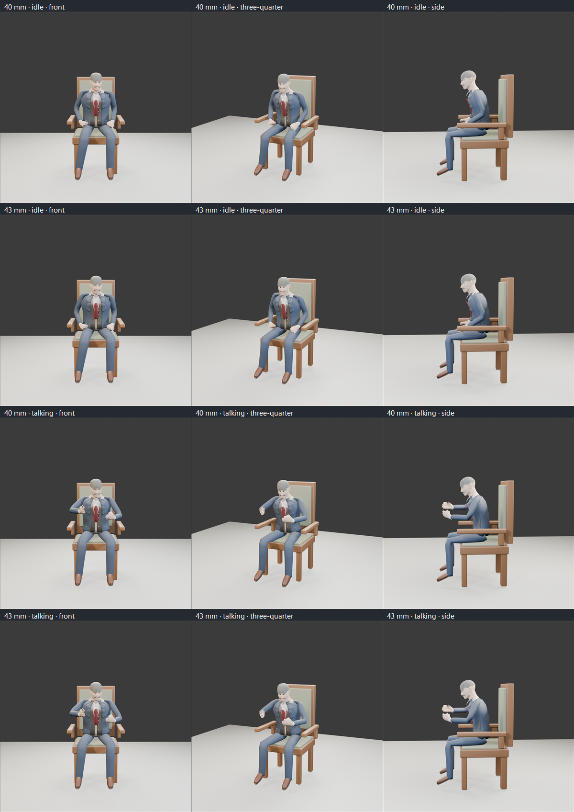
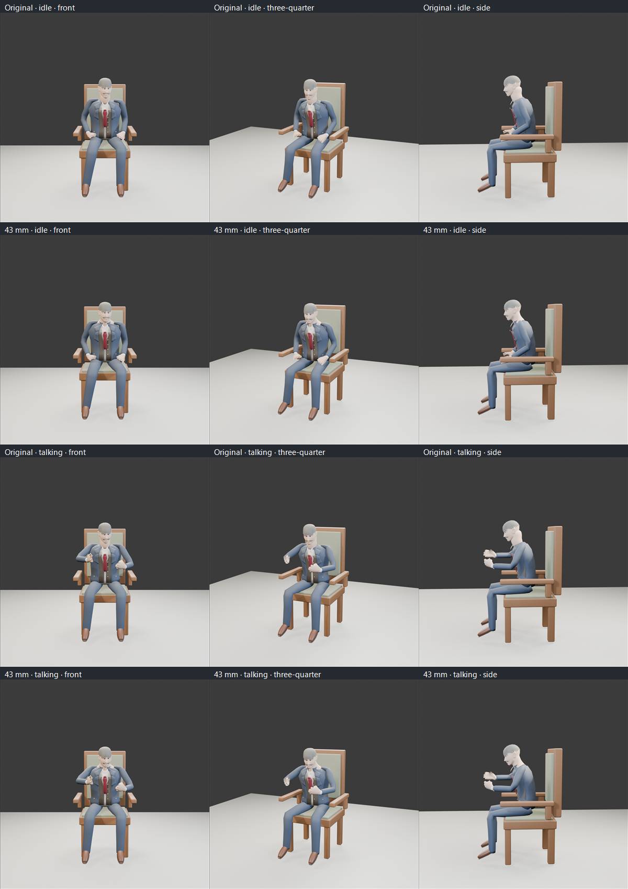
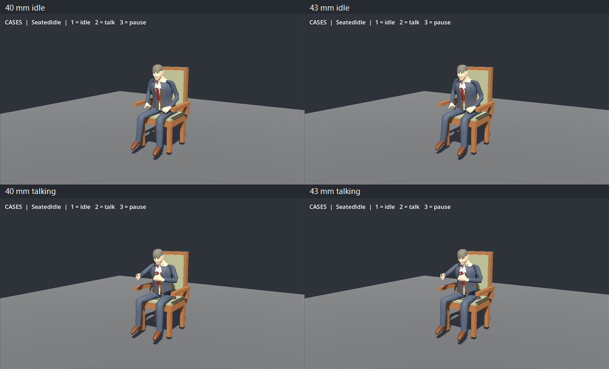
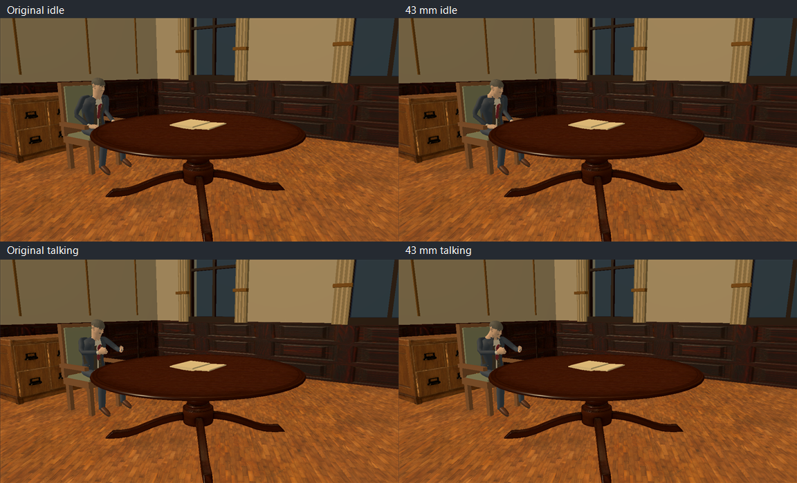
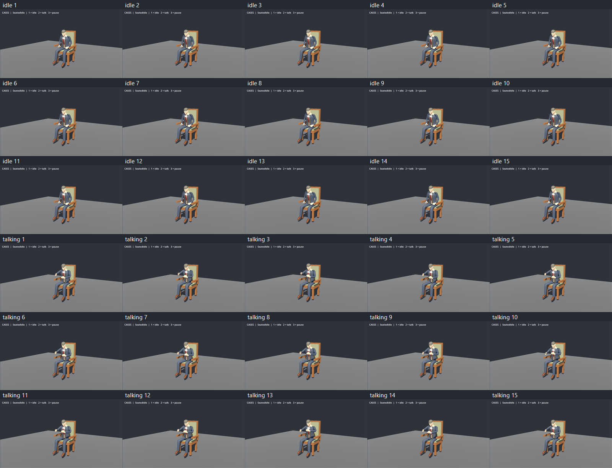
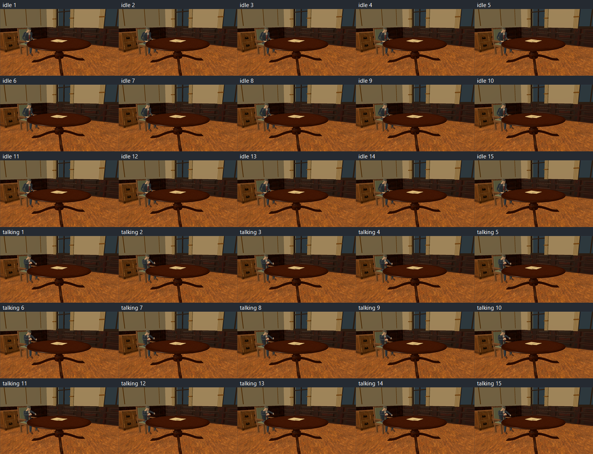
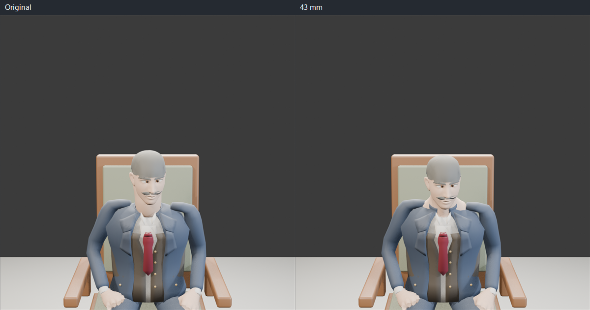

# Suited Negotiator V2.1 geometry repair

Recorded 18 November 2026 on Windows with Blender 4.2.2 and Godot 4.7.2 stable. Run from the repository root with `.\build_and_validate.ps1`.

## Geometry changes

The Quaternius `SuperHero_Male` source and its 65-bone humanoid rig remain in use. The sleeve roots now extend 0.115 m under the jacket shell and widen across staged, bone-aligned rings. The cap is buried inside the torso, and shoulder weights blend from the clavicle into the upper arm before continuing across the elbow.

Body trimming no longer keeps polygons by broad face-center boxes. It identifies head geometry from the source `Head` vertex group, rejects the separate 230-face flared neck component, and retains the larger connected head surfaces. A tapered neck loft bridges the head and shirt collar with `neck_01`, `Head`, and `spine_03` weights. The head-weighted skin and face details are lowered 25 mm together to reduce the exposed neck while preserving jaw contact and rigging; the loft remains scaled to 92% around its midpoint and overlaps the head and collar. A shaped, skinned rear jacket yoke meets the collar and closes the open neckline edge.

Hand extraction now uses a plane derived from each lower-arm rest-pose bone, retaining the hand plus a short wrist overlap inside the cuff. Connected components under 50 faces are discarded to remove detached wrist fragments. Original hand vertex groups and skinning remain intact.

## Build and Godot validation

`build_and_validate.ps1` completed successfully after regenerating the Blender source, GLB, and previews.

- Blender 4.2.2 generated the editable `.blend`, exported the GLB, and rendered the full V2 preview set.
- Godot 4.7.2 imported a 65-bone skeleton with `SeatedIdle` and `SeatedTalking`.
- **40 skinned meshes / 40 weighted surfaces** passed valid-bone and normalized-weight checks.
- The validator sampled seven times in each animation. Both clips applied bone transforms and the character root remained fixed.
- Pelvis height was **0.583530 m** in both seated states.
- The Compatibility-renderer demo started without runtime errors and produced a nonblack **1152 x 648** Movie Maker frame at `art_source/output/v2/godot_engine_capture00000000.png`.

The full run transcript is `art_source/output/v2/build_validation_transcript.txt`; the Godot capture log is `art_source/output/v2/godot_capture.log`.

## Visual inspection

Blender regenerated front, three-quarter, and side idle views; front and three-quarter talking views; shoulder/cuff details; and talking frames 1, 10, 22, 30, 45, and 60. The shoulder, neckline, and wrist close-ups were reviewed alongside talking frames 22 and 30. The saved comparison uses the same cameras and animation frames for V2.0 and V2.1:



The committed representative previews include the current contact sheet, front idle/talking views, both sleeve details, frames 22 and 30, and the before/after comparison. Run the generator or full build to refresh the other views. The Godot capture confirms the model renders in the target engine:



## Remaining limitations

The sleeves now meet the jacket through the inspected idle and talking poses, though the low-poly shoulder silhouette is still somewhat rounded. The large source neck flaps and isolated pointed wrist pieces are absent in the reviewed frames. Lowering the head-weighted skin and face details shortens the exposed neck while keeping the jaw connected to the neck loft; the side and three-quarter profiles were reviewed in Blender, and the rebuilt model was imported into the Godot room preview. A narrow dark inner-collar seam remains at the shirt, and the three-piece suit and face are still stylized. The Godot frame shows the full chair and character at the existing demo camera distance, so Blender close-ups remain the more useful view for garment detail. These results cover the saved animation samples, not every interpolated frame.

## V3 original delegate personas

Recorded 18 November 2026 on Windows with Blender 4.2.2 and Godot 4.7.2 stable. The variant-only command is `.\build_variants.ps1`; it was run from the feature worktree and does not call `build_and_validate.ps1`.

### Build and integrity

- Blender generated separate GLBs and editable `.blend` files for `senior_mediator`, `younger_envoy`, and `scholarly_delegate`. Each received ten 1200×1200 Blender views, including idle front/three-quarter/side, talking, frames 22 and 30, both sleeve details, jacket, and face.
- The senior mediator uses overlapping, skinned double-breasted front panels and two button columns. The younger envoy uses a slimmer blue single-breasted profile; the scholarly delegate has an olive suit and neat beard. All three are original archetypes with distinct face/build/style settings, not historical portraits.
- All 14 persona unit tests pass. Input preflight tests cover finite/bounded and missing dimensions, unknown hairstyle/facial-hair/suit-style values, unknown keys, missing palette fields, and malformed or out-of-range RGB colors. All profiles resolve through the shared face-point transform for the head and its attached features.
- The labeled four-character Blender sheet is `art_source/output/v3/four_character_contact_sheet.png`. The engine view and Blender/Godot comparison are `art_source/output/v3/godot_variant_lineup.png` and `art_source/output/v3/four_character_blender_godot_comparison.png`.
- The Godot capture is 1152×648, rendered with OpenGL 3.3 Compatibility on an NVIDIA RTX 3060. The comparison shows the imported GLBs side by side with Blender previews; Godot's framing and lighting are not pixel-identical to Blender.
- A fresh temporary Godot project imported all four GLBs. Per-character state and failure counters reset for each model. Each asset exposed 65 bones, both seated clips, 39–45 skinned meshes, and all mesh surfaces had valid bones and normalized weights. Each clip sampled seven times and individually changed all 11 required bones (`Head`, `neck_01`, `spine_03`, both clavicles, upper arms, lower arms, and hands). The character root remained fixed, and pelvis height was 0.583530 m in both seated clips. Result: four assets, zero validation failures. The unchanged single-character demo also loaded both animations.
- `art_source/output/v3/legacy_sha256.txt` records matching before/after SHA-256 values for the Quaternius source GLB, the original Blender `.blend`, and the original Godot GLB. All three are unchanged.

### Visual review and remaining defects

The labeled Blender contact sheet and Godot import comparison were inspected alongside both animation frames and garment/face close-ups. The four suits and head treatments are distinguishable, and the engine import shows all four animated assets. The previews still show the base model's stylized low-poly anatomy: shoulders remain somewhat broad and rounded, the senior's double-breasted front reads plate-like, and a thin dark seam remains around the neck/collar. The collar, shirt, and tie also look crowded in close-up; hand/cuff transitions, facial details, and hair/beard silhouettes remain blunt and stylized. These are visible appearance limitations, not failed rig/import checks. The talking samples cover frames 22 and 30 plus the validator's seven evenly spaced samples, not every interpolated frame.




## Variant reproduction

From the repository root, run `.\build_variants.ps1` to rebuild only the three variants, render their previews, import and validate all four characters in a disposable Godot project, capture the engine lineup, and verify the three legacy hashes. It accepts `-BlenderPath` / `-GodotPath`, or `BLENDER_EXE` / `GODOT_EXE`. Run `python -m unittest art_source.tests.test_persona_presets -v` for the data and input-validation tests. Use the older `.\build_and_validate.ps1` only when intentionally rebuilding the legacy default character.

## V2 reproduction

From the repository root, run `.\build_and_validate.ps1`. It locates Blender and Godot through command-line parameters, environment variables, `PATH`, or documented Windows defaults; regenerates the character; imports it into Godot; runs `godot/tests/validate_suit.gd`; starts the demo; and captures a Compatibility-renderer PNG.

## V2.2 Quaternius source-neck repair

Recorded 18 November 2026 on `codex/versailles-seated-character` (base commit `e8ba44f`; working tree remains intentionally dirty). This section supersedes the V2.1 neck-replacement notes above. The original user-dirty worktree files were backed up before rebuilding to `C:\Users\marcu\AppData\Local\Temp\cases-neck-repair-backup-20261118`; its manifest contains SHA-256 hashes for all 21 pre-existing modified files.

### Implementation

- The default negotiator now retains the complete Quaternius `SuperHero_Male` head and neck components selected from the original connected mesh by `Head` and `neck_01` weights. The full source neck component is 536 faces; it is no longer cut down to only the 230 faces that pass a head-weight threshold.
- A single parameter, `DEFAULT_NECK_HEAD_DROP_M = 0.043`, lowers source head and neck components together by 43 mm in rest space. The same drop is applied to the original weighted eyes and brows and to generated head-attached details. `--neck-head-drop-m` accepts 0 to 60 mm for bounded review.
- The custom `make_neck()` loft and its obsolete `neck_length_scale` preset field are removed. A small rise in the existing jacket neckline/yoke extends its coverage by 20 mm. No replacement neck geometry is generated.
- Only the default character was rebuilt. The Quaternius source files and the three alternate character GLBs were not modified.
- SHA-256: source base character `D6F3B64CAB629F6DDCA9BA063811AEFFD3663A8A4E49ADE47CD9505DC2BBD70F`; source animation library `4C748767741A3E495D89667B9A218B690BA9810B9517A12E960780E3CA72C4E9`; rebuilt default character `12FDDD092DEEA55FBD76838F74B7F773D182BE7BC652F10AEFB65EFEF404C23E`.

### Build and checks

Rebuild from the project root with:

```powershell
.\build_and_validate.ps1 -BlenderPath 'C:\Program Files\Blender Foundation\Blender 4.2\blender.exe' -GodotPath 'D:\tools\Godot-4.7.2\Godot_v4.7.2-stable_win64_console.exe'
```

The final production run passed with Blender 4.2.2 and Godot 4.7.2. Godot imported all four character assets; the default has 65 bones, 39/39 skinned/weighted surfaces, both seated clips, and no replacement neck loft. All 11 required animated bones changed in each clip across 15 evenly spaced samples, the actor root stayed fixed, and pelvis height remained 0.583530 m in both clips. The other three character variants also passed their existing checks. `python -m unittest art_source.tests.test_persona_presets -v` passed all 14 tests, and Blender's neck-repair artifact contract passed both checks on the final `.blend`.

The 43 mm trial was first built under a temporary artifact root and imported into an isolated Godot project; the same four-asset validator passed before the production GLB was replaced. The final production GLB was captured in Godot's Compatibility renderer (OpenGL 3.3, NVIDIA RTX 3060): 15 samples each for `SeatedIdle` and `SeatedTalking`, in both the seated demo and Versailles room. The room capture uses its existing `SeatedDemoCameraReference` marker because the room scene has no active camera. The actor remains aligned to its chair and table through both clips. Blender and Godot comparisons and contact sheets are under `art_source/output/v2/neck_repair/`; the reproducible Blender comparison script is `art_source/scripts/render_neck_repair_views.py`. Re-capture either scene with `Godot --path godot --script res://tests/capture_seated_animation_frames.gd -- <scene-path> <absolute-output-dir>`.

### Visual review and remaining limitation

The follow-up requested a little more drop than the original 40 mm setting. A 43 mm pass lowers the original head and neck a further 3 mm while retaining acceptable head-to-shoulder proportions in the front, three-quarter, and side views. The 45 mm trial sat too low, so 43 mm is the selected compromise. The head remains attached and not obviously sunken in the sampled Godot scenes. A low-poly skin shelf is still visible in close Blender views around the collar/shoulder transition; it is reduced at game distance and does not form a gap or animate through the clothes in the sampled frames. Ready for CASES v1 with that close-up cosmetic limitation documented.














